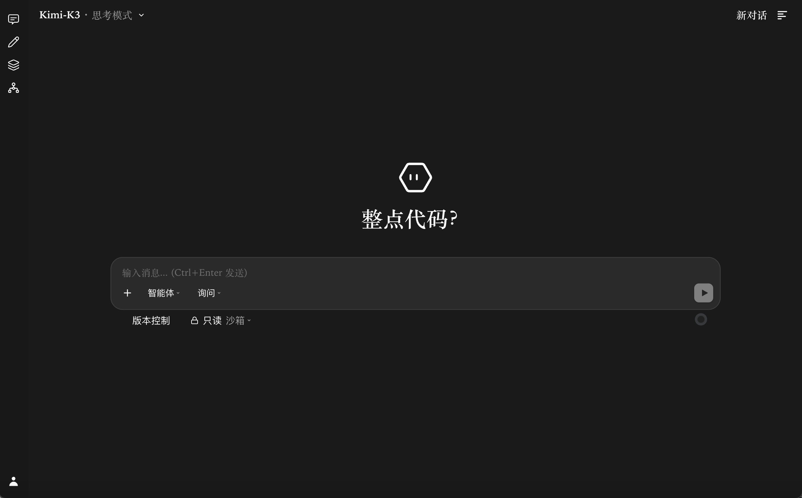

# Astrion

**自托管的全能型 AI 智能体系统**——把文件、终端、搜索、多模态、子智能体与 MCP 工具统一到一个可审计、可管控的 Agent 循环里。

> 命名：`Astr-`（星）+ `-ion`（粒子）。Agent 像星际间传递信号的粒子，把人类意图传递到工具、文件、终端与子智能体之间。



---

## ⚠️ 重要声明

- **本项目处于开发中，不要用于正式生产环境。**
- 宿主机沙箱已在 **macOS（sandbox-exec）** 与 **Windows（WSL2）** 完成测试；**Linux 首批适配 Ubuntu 24.04**（bwrap + seccomp + AppArmor + systemd/cgroup IP 过滤），已完成隔离环境实测，须由管理员安装受限助手，Astrion 本体以普通用户运行。其它 Linux 发行版和全局安装流程尚需实机验收，详见 [Linux Host 沙箱](docs/agents_details/linux_host_sandbox.md)。
- 主仓交付 **Host Web、本机 CLI、macOS / Windows 桌面端（含 Quick Chat）与本机沙箱**。多用户 Web 服务、Docker 镜像、普通账号、API 用户与 Android 工程归入独立 Docker 版的拆分范围。现有 Docker 部署继续使用对应旧版本，详见 [拆分方案](docs/docker_fork_split_plan.md)。
- 本项目的大量设计借鉴了 **Codex、Claude Code、OpenCode、OpenClaw** 等智能体产品的优秀实践，特此致谢。

## 核心特性

- **完整的 Agent 循环**：流式输出 + 工具调用编排，内置文件操作、持久终端、网络检索、图片/视频理解、待办与记忆等工具
- **Host 优先**：Host Web、CLI 与桌面端共用同一个本机后端；终端执行走宿主机 OS 沙箱，不依赖 Docker
- **双层安全模型**：权限模式（`readonly` / `approval` / `auto_approval` / `unrestricted`）× 执行环境（沙箱 / 直接执行）
- **子智能体与多智能体**：主进程内并行子智能体（独立上下文、可后台运行）；实验性多智能体团队模式
- **技能系统（Skills）**：可插拔技能包，模型按需加载（内置技能包未随公开仓库分发，可在 `<数据根目录>/host/agentskills/` 下自行创建）
- **MCP 扩展**：接入任意 MCP 服务，工具自动映射进 Agent 工具箱
- **提供商与模型体系**：内置 21 家服务商目录，填入 API key 自动拉取全部可用模型；Chat Completions / Responses 双协议支持；也兼容手写 OpenAI 兼容条目与 Codex 订阅 OAuth；模型可见性按用户开关，思考模式切换、推理强度档位、多模态声明齐全
- **工程化细节**：对话持久化与跨工作区搜索、文件版本快照回滚、Token 统计、日志轮转、运行态数据外置（源码树零污染）

## 运行模式

主仓只交付 `host` 模式：本地个人智能体，终端命令在宿主机 OS 沙箱内执行。

| | Host 模式 |
|---|---|
| **定位** | 本地个人智能体 |
| **终端执行** | 宿主机 OS 级沙箱（macOS `sandbox-exec` / Windows WSL2 / Linux 受限助手；Linux 首批 Ubuntu 24.04 隔离实测） |
| **可登录账号** | 默认本机免登录；开启 Host 网页密码后只使用密码登录 |
| **数据目录** | `<数据根>/host/` |
| **默认监听** | Host Web 默认监听 `127.0.0.1`。`WEB_SERVER_HOST`、`server.host` 或 `--bind` 可显式指定监听地址 |
| **用户注册** | 单人使用，无需注册 |
| **前置要求** | Windows 安装 WSL2 沙箱；Linux 管理员安装受限助手（见安装说明） |

启动模式由 `TERMINAL_SANDBOX_MODE` 决定（在 settings.json 的 `terminal.sandbox_mode` 或环境变量中设置），**在进程启动时锁定，运行中不可切换**。

> 旧配置中的 `web` / `docker` 模式与 `LINUX_SAFETY` 不属于本仓 Host 交付。旧 Docker/Web 部署继续使用对应旧版本，详见 [拆分方案](docs/docker_fork_split_plan.md)；本机使用请完成显式 Host 配置迁移。

## 快速开始

**环境要求**：Python 3.10+、Node.js 18+。

```bash
# 1. 克隆
git clone https://github.com/JOJO6618/astrion.git
cd astrion

# 2. 初始化：创建 venv、安装依赖、运行交互式配置向导
#    向导会依次询问：监听地址/端口 → 数据目录 → 模型 API（并自动生成会话密钥）
./setup.sh

# 3. 构建前端和 Rust 后端
npm install && npm run build
cargo build --locked --release --manifest-path backend-rust/Cargo.toml

# 4. 启动 Host Web
./start.sh
# 或：python3 -m server.app --port 8091
# 或：python3 main.py
```

访问 `http://localhost:8091`。Host 模式默认本机免登录。启用 Host 网页密码后使用密码登录，详见下文。桌面端免密码。

上面的启动命令均使用 Rust 后端。需要对照旧 Flask 实现时，运行 `python3 -m server.app --backend python`。Rust 和 Python 实例共用数据根时只能启动一个。

> Linux 首次使用还需由管理员安装 Host 沙箱助手：`sudo bash scripts/setup-linux-sandbox.sh`。Windows 首次使用按设置页向导安装 WSL2 沙箱。
>
> 说明：`setup.sh` 向导当前将配置写入仓库根目录 `.env`（开发备用方式）。
> 生产部署建议按「配置」一节迁移为 `<数据根目录>/settings.json` 或系统环境变量。

### CLI（beta）

终端 TUI 客户端（opentui + React 19，需 bun ≥ 1.3）：

```bash
bun cli/src/main.tsx   # 或 npm --prefix cli run dev；当前目录即工作区
```

CLI 通过本机 Gateway Bearer 连接服务，探测到无服务时默认启动 Rust headless 后端。源码安装先执行 `cargo build --locked --release --manifest-path backend-rust/Cargo.toml` 和 `node desktop/scripts/prepare_rust_backend.mjs`。命令入口为 `cli/bin/astrion`，加入 PATH 后可直接使用 `astrion` 命令。显式配对已有实例时设置 `ASTRION_API_BASE` 与 `ASTRION_HOST_TOKEN_FILE`。

### Host 网页密码（可选）

默认沿用本机免登录。需要密码保护时，在源码目录运行：

```bash
python3 scripts/host_password.py --password 'YOUR_PASSWORD'
```

将 `YOUR_PASSWORD` 替换为 8 至 1024 个字符的密码。每次执行都会设置密码并开启保护，旧网页登录会话随即失效，无需重启服务。脚本默认使用服务同一套 `DATA_DIR` 配置；也可通过 `--data-dir /absolute/path/to/data` 显式指定目标实例的数据目录。

启用后，Host 登录页只显示密码登录。设置 → 通用可验证当前密码后关闭保护；再次开启或重设密码仍运行上述脚本。配置保存为 `<DATA_DIR>/host_auth.json`（scrypt 哈希、0600、原子写），不保存明文。桌面端免密码，本机 CLI/headless Bearer 通道独立保留。

## 数据存储

Host 运行态数据默认位于 **`~/.astrion/astrion/`**。桌面端默认使用 `~/.astrion/astrion-desktop/`（Windows 下位于 `%USERPROFILE%`），目录结构相同。

```
~/.astrion/astrion/           ← 数据根目录（ASTRION_DATA_ROOT 可整体搬迁）
├── settings.json             ← 本机配置（手动维护）
├── config/                   ← 部署级配置（custom_models.json 等）
└── host/                     ← Host 运行态
    ├── data/                 ← 对话、记忆、子智能体任务等
    └── logs/
```

路径解析优先级（高→低）：

1. **具体目录变量**：`DATA_DIR` / `LOGS_DIR`（单独覆盖某个目录）
2. **`ASTRION_DATA_ROOT`**：整体搬迁数据根目录
3. 兜底默认：`~/.astrion/astrion/host/`

以上均写在仓库根目录 `.env` 或系统环境变量中。

## 配置

**推荐方式**：`<数据根目录>/settings.json`（统一配置）或系统环境变量。
**开发备用**：仓库根目录 `.env`（`setup.sh` 向导生成，`cp .env.example .env` 手动编辑亦可）。

加载优先级：系统环境变量 > settings.json > .env。

### settings.json

位置：`<数据根目录>/settings.json`（如 `~/.astrion/astrion/settings.json`），**手动创建维护**。
其中 `env_vars` 的原样注入环境变量（放各类 API Key）；点分字段按下表映射为旧版环境变量。

```json
{
  "terminal": {
    "sandbox_mode": "host",
    "execution_mode_default": "sandbox",
    "macos_writable_paths": "",
    "project_max_storage_mb": 2048
  },
  "server": { "port": 8091, "host": "127.0.0.1" },
  "admin": {
    "secondary_password_hash": ""
  },
  "secrets": {
    "web_secret_key": "<随机 hex>"
  },
  "models": { "default_response_max_tokens": 32768 },
  "search": { "tavily_api_key": "", "tavily_api_key_2": "" },
  "env_vars": {
    "API_BASE_KIMI": "https://api.moonshot.cn/v1",
    "API_KEY_KIMI": "sk-..."
  }
}
```

| 字段 | 映射环境变量 | 说明 |
|---|---|---|
| `terminal.sandbox_mode` | `TERMINAL_SANDBOX_MODE` | **启动模式**：`host`（主仓仅交付 Host；旧 `web` / `docker` 部署继续使用对应旧版本，见拆分方案） |
| `terminal.execution_mode_default` | `HOST_EXECUTION_MODE_DEFAULT` | 宿主机执行环境默认：`sandbox` / `direct` |
| `terminal.macos_writable_paths` | `HOST_SANDBOX_MACOS_WRITABLE_PATHS` | macOS 沙箱额外可写白名单（逗号分隔） |
| `terminal.project_max_storage_mb` | `PROJECT_MAX_STORAGE_MB` | 单项目存储上限 |
| `server.port` / `server.host` | `WEB_SERVER_PORT` / `WEB_SERVER_HOST` | Web 监听 |
| `admin.secondary_password_hash` | `ADMIN_SECONDARY_PASSWORD_HASH` | 敏感操作二级密码（未配置时相关管理接口校验失败） |
| `secrets.web_secret_key` | `WEB_SECRET_KEY` | Session 签名密钥（随机 hex；未配置时使用临时密钥，重启后所有登录会话失效） |
| `models.default_response_max_tokens` | `AGENT_DEFAULT_RESPONSE_MAX_TOKENS` | 单轮响应 token 全局上限 |
| `search.tavily_api_key(_2)` | `AGENT_TAVILY_API_KEY(_2)` | Tavily 搜索 Key（可选） |
| `env_vars.*` | 原样注入 | 任意环境变量（API Key、沙箱参数等） |

> ⚠️ **以下字段已弃用/无效**，存在于旧配置中可删除：
> - `terminal.direct_ttl_seconds`（direct 模式自动回退 TTL，已从代码移除）
> - `models.default_model_key`（无效；默认模型用环境变量 `AGENT_DEFAULT_MODEL` 或设置页「模型偏好」的用户级默认值，否则取模型库第一个可见模型）
> - `flags.api_dump_enabled`（无效；API 请求落盘请用环境变量 `AGENT_API_DUMP_ENABLED=1`）
> - `env_vars` 中的 `AGENT_API_*` / `AGENT_THINKING_*` / `AGENT_TITLE_*` 三件套（已从代码移除，模型统一走 custom_models.json）

### 模型注册（提供商 / 手写 / Codex）

系统不内置任何供应商模型。**推荐通过设置页连接提供商**；旧版的手写 `custom_models.json` 方式完整保留兼容。模型库由三条路径合并而成：

1. **设置页连接提供商（推荐）**：Web 界面「设置 → 提供商」内置 21 家服务商目录（DeepSeek、Moonshot、智谱、阿里云百炼、火山方舟、SiliconFlow、MiniMax、OpenAI、OpenRouter、Google Gemini、xAI、Groq、Together、Mistral、OpenCode Zen/Go，以及本地 Ollama / LM Studio），填入 API key 即自动拉取该服务商全部可用模型注册进模型库；也可以添加自定义 OpenAI 兼容提供商。凭证保存在 `<数据根目录>/host/data/providers.json`（0600 权限，不纳入 git）。
2. **手写 custom_models.json（旧版兼容）**：旧版的手动注册方式，完整保留且已 UI 化——手写条目自动出现在设置页「模型」分区的「自定义」分组，可在界面直接增删改（字段见下表）。
3. **Codex 订阅 OAuth**：OpenAI 在目录中拆为两条——`OpenAI`（API key）与 `OpenAI Codex`（ChatGPT Pro/Plus 订阅授权，在设置页连接，授权后自动获取订阅包含的模型）。

**协议支持**：Chat Completions 与 OpenAI **Responses** 双协议（Responses 按加密 reasoning 处理，多轮回传保持推理连续性）。Anthropic Messages / Google 原生协议的模型会正常注册显示，但当前版本调用时会明确报错（不做协议适配）。

**模型可见性与偏好**：设置页「模型」分区的可见性开关为**每用户独立**；「模型偏好」分区设置每用户的默认模型 / 默认思考模式 / 默认推理强度。

#### custom_models.json 字段参考

读取回退链：
`<数据根目录>/config/custom_models.json` → 源码树 `config/custom_models.json` → `config/custom_models.json.example`。

完整示例见 [config/custom_models.json.example](config/custom_models.json.example)。字段说明：

| 字段 | 必填 | 说明 |
|---|---|---|
| `model_name` | ✅ | 模型唯一键（系统内引用名） |
| `url` | ✅ | API 地址（OpenAI 兼容）。支持环境变量引用：`${VAR}`、`env:VAR`、`$VAR`、直接写全大写 `VAR` 名 |
| `apikey` | ✅ | API Key，引用语法同上——**密钥不写进 JSON，由 settings.json 的 `env_vars` 或环境变量提供** |
| `thinkmode_status.model_id` | ✅ | 上游真实模型 ID（或改用顶级 `model_id` 字段） |
| `thinkmode_status.type` | | `param_toggle`=同一模型通过参数切换思考（配 `fast_extra_parameter` / `thinking_extra_parameter`）；`switch_model`=快慢两个模型（配 `fast_model_id` / `thinking_model_id`） |
| `visible` | | 前端是否可见（默认 `true`） |
| `description` / `display_name` / `model_description` | | 展示描述；`model_description` 会注入系统提示词告知模型自身身份 |
| `multimodal` | | `none` / `image` / `image,video` |
| `reasoning_capability` | | `fast` / `thinking` / `fast,thinking` |
| `reasoning_effort` | | `true` 时思考模式下前端可选推理强度档位 |
| `context_window` / `max_output_tokens` | | 上下文窗口 / 单轮输出上限 |
| `extra_parameter` | | 注入每次请求的额外参数（与 fast/thinking 参数合并） |

### 子智能体 / 审核智能体模型

子智能体、审核智能体、标题生成等辅助调用的模型**统一来自主模型注册表**（提供商同步 + 手写 custom + Codex 合并），不再有独立的子智能体模型库——旧版 `sub_agent_models.json` 已于 2026-09 彻底废弃（无向后兼容，`SUB_AGENT_MODELS_CONFIG_FILE` 同步失效）。

- **配置点各自独立**：设置页「子智能体」默认模型、「审核智能体」各自的模型、「通用」标题生成模型、多智能体角色定义的 `model` 字段；
- **留空走自动规则**：注册表第一个可见模型（纯 Codex 环境下优先选 `-luna` 轻量款）；
- **创建锁**：子智能体创建时记录所用模型 key，重跑/恢复强制复用同一模型。

### Host 登录与管理员二级验证

Host 模式默认本机免登录。需要网页密码时按上文「Host 网页密码」运行：

```bash
python3 scripts/host_password.py --password 'YOUR_PASSWORD'
```

`setup` 向导不再创建旧管理员账号。

敏感操作的管理员二级密码仍保留：生成哈希后写入 settings.json 的 `admin.secondary_password_hash` 或环境变量 `ADMIN_SECONDARY_PASSWORD_HASH`：

```bash
python3 -c "from werkzeug.security import generate_password_hash; print(generate_password_hash('你的二级密码'))"
```

## 项目结构

```
├── main.py / server/        # Flask 后端（chat / status / tasks 子包）
├── core/                    # Agent 循环与工具编排
├── modules/                 # 能力模块（终端 / 文件 / 记忆 / 子智能体 / MCP …）
├── config/                  # 配置聚合、路径解析、模型注册
├── utils/                   # API 客户端、上下文与对话管理
├── prompts/                 # 系统提示词
├── static/src/              # Vue 3 + TypeScript Web 前端
├── cli/                     # opentui + React 19 终端 CLI（bun，命令名 astrion）
├── desktop/                 # 桌面壳与原生模块
├── desktop-electron/        # macOS / Windows Electron 桌面端
├── scripts/                 # 安装、构建与维护脚本
└── docs/                    # 设计文档
```

## 文档与测试

- 宿主机沙箱与权限模型：[docs/agents_details/permission_and_sandbox.md](docs/agents_details/permission_and_sandbox.md)
- Linux Host 沙箱安装与限制：[docs/agents_details/linux_host_sandbox.md](docs/agents_details/linux_host_sandbox.md)
- 运行态数据路径：[docs/agents_details/runtime_data_paths.md](docs/agents_details/runtime_data_paths.md)
- 提供商与设置页 API 契约：[docs/providers_api.md](docs/providers_api.md)

```bash
python -m pytest test/历史测试_日期不明/test_server_refactor_smoke.py -q       # 后端冒烟
cd cli && ./node_modules/.bin/tsc --noEmit                   # CLI 类型检查
```

## 致谢

- 设计借鉴：Codex、Claude Code、OpenCode、OpenClaw
- 图标基于 Lucide 等开源图标库修改

## 许可证

[MIT](LICENSE)

---

> 本项目仅供学习与研究使用，请遵守所接入模型/API 服务商的使用条款。
