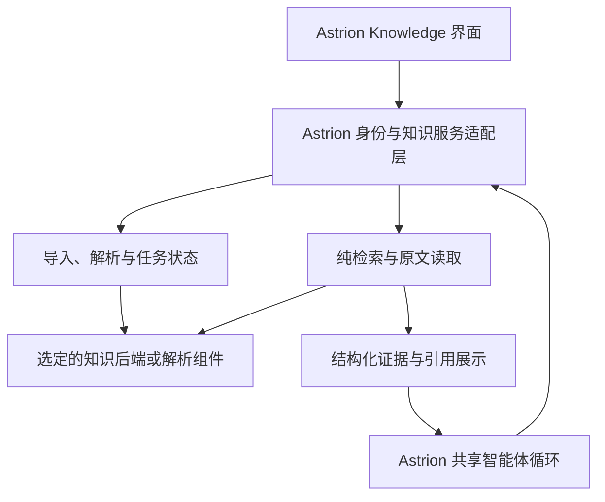

# Astrion Knowledge：开源复用调研与工程难点

> 日期：2026-10-27。
> 状态：选型研究，未批准或开始 Knowledge 业务实现；本文不是既定实施契约。
> 归档确认：用户在本轮调研答复后要求「先也一样，落盘一下吧」，本文与项目记忆同步保存当前讨论；不据此推定最终选型或集成授权。
> 产品目标：智能体辅助管理的个人知识库。复用成熟项目的管理、解析、存储和检索能力，接入 Astrion 自己的智能体系统。

## 1. 结论与建议

可大量复用，但要区分两类工程路线：

1. **完整知识后端外置服务**：复用资料库、上传、解析、索引和纯检索 API，Astrion 保留界面、用户身份、智能体循环和引用展示。AnythingLLM、RAGFlow 是本轮优先验证候选。
2. **组件组合**：Docling 等负责解析，现成检索框架和向量数据库负责分块／索引／搜索，Astrion 补任务、元数据、权限与资料生命周期。部署形态更可控，但比接完整服务需要写更多业务胶水。

本轮推荐：先以统一的纯检索适配契约，对 **AnythingLLM 与 RAGFlow** 做同语料概念验证，再决定默认引擎；**Docling** 是解析组件的优先验证项。Open WebUI 值得深入参考或作为独立服务候选，但不能忽略当前许可证。不要一开始把几个完整平台全部部署，也不要为了复用而迁入它们的聊天／Agent 主循环。

这不是已完成的集成或性能结论，不是已经决定采用哪个项目。

## 2. 调研方法与证据范围

- 使用三个低智能程度子智能体分别调查完整后端、个人知识库、文档解析器；主智能体复核关键代码与许可证。
- Open WebUI 使用用户已有 ZIP：`.astrion/user_upload/open-webui-main (1).zip`。包内版本为 0.12.3；无 Git 元数据，不能确认 commit SHA。
- GitHub git 端点连接超时；完整 codeload 归档下载也未完成。按用户要求，主智能体下载统一使用持久终端；随后改为官方 GitHub contents API 按固定 SHA 拉取关键源码。
- **没有成功 clone 完整候选仓库。** 未完成的 ZIP 不能当成可用源码包。实际判断依据是本地 Open WebUI 源码、按 SHA 获取的部分文件，以及官方文档。
- 解析器子任务的部分文件来自固定 SHA 的 jsDelivr 镜像；jsDelivr 是第三方 CDN，并非 GitHub 官方 CDN。主智能体另从官方 API 获取 Docling Excel 后端与 README 进行复核。
- 未安装候选系统、未启动知识后端、未下载模型权重、未跑解析或检索基准，未读取真实凭据或导入用户知识文件。

### 2.1 固定版本

| 项目 | 本次源码标识 | 实际代码核验范围 |
| --- | --- | --- |
| Open WebUI | 本地 ZIP，package.json 0.12.3，无 SHA | 知识／文件／检索路由、loader、存储及访问控制等抽取文件 |
| AnythingLLM | `9b1fcab141000eaba9f78ed131151de04904454b` | 15 个关键文件，非完整仓库 |
| RAGFlow | `88321d6aad99d234b6effc14f82f9d014b4bfc6b` | 主复核 README、LICENSE；检索字段主要依据官方 HTTP API 文档 |
| Dify | `80265fcfe110f0aea056fcb3566d322986014b78` | LICENSE、service_api/wraps、dataset 路由、hit_testing 路由 |
| Docling | `733106766a67c0804d2f52eed253648fb427fe74` | 格式注册、转换分派、Office 后端、pyproject、LICENSE、README |
| MinerU | `b7f3dd0c5f6e6d66a298239ffd02b328b873918e` | pyproject、LICENSE；格式／输出／资源主要依据官方文档 |

SHA 是调查时分支快照，不代表最新稳定发布。实施时应另选稳定版本并锁定接口。

## 3. 候选项目比较

### 3.1 AnythingLLM：个人知识库服务候选

- 仓库：https://github.com/Mintplex-Labs/anything-llm
- 有独立 `POST /v1/workspace/:slug/vector-search`，返回片段文本、文档元信息、distance、score，不必调用其聊天生成。
- 已读 LanceDB 路径的 `performSimilaritySearch`，会计算 query embedding 并搜索，可选 rerank；虽然参数名是 `LLMConnector`，该路径不等于生成一遍聊天答案。
- 其 workspace 是知识空间，不是 Astrion 的执行工作区。适配层必须避免概念混用。
- 已读 API Key 中间件和 vector-search 路由：前者验证实例 API Key，后者按 slug 取空间，未见该接口按调用用户限定 workspace。不能把实例 Key 交给前端，需由 Astrion 后端强制映射允许访问的知识空间。
- 解析 collector 与服务端分离；完整格式目录不等于逐格式质量或引用定位保证。本轮没有逐个运行解析器。
- 该纯检索响应映射未提供通用的页码／bbox 字段；不能因此承诺任意格式都可点回原文位置。
- LICENSE 主复核为 MIT；复用仍保留许可与版权声明。

**判断**：适合尽快验证完整个人知识服务接入。待重点验证引用定位、中文混合检索质量、导入恢复、增量更新和资源占用。

### 3.2 RAGFlow：文档理解与引用链路候选

- 仓库：https://github.com/infiniflow/ragflow
- 官方 HTTP API 将 dataset、文档、chunk 与 retrieval 作为独立能力；可不使用其 chat／agent 生成端点。
- 检索响应样例保留 `positions`、`image_id`、文档身份与 `similarity`／`term_similarity`／`vector_similarity` 等字段。
- `positions` 在样例中也可能为空；字段存在不代表每种格式都有有效坐标。坐标原点、单位、页号及多框语义仍需按实际版本核验，不承诺现成的跨格式原文高亮。
- 已读固定 SHA README：**建议起步配置**为 4 CPU、16GB RAM、50GB 磁盘；不是本轮实测，也不是每种部署的硬最低值。README 另说明当前部署与构建的平台限制，需要单独核对 Apple Silicon／macOS 适用性。
- 本次 README 已涉及 1.0 / Go 服务与原生依赖；不能沿用旧版 Python 服务职责或旧 API 路径假设。主未完整核验其内部任务／跨存储补偿，不对删除一致性下确定结论。
- 主已读 LICENSE 为 Apache-2.0。

**判断**：值得验证复杂 PDF、表格和引用能力；不适宜未经测试就作为所有桌面用户的默认常驻重依赖。

### 3.3 Open WebUI：管理、权限与多解析器接入的参考

- 仓库：https://github.com/open-webui/open-webui
- 本地源码有独立 `/api/v1/retrieval/query/doc` 与 `/query/collection`，执行集合 ACL 校验，并调用 embedding／向量或混合检索。
- 文件、知识集合、原件存储、向量集合有独立管理链路；删除文件会清知识关联、相关向量、文件记录和原件。
- 但删除逻辑存在多个存储步骤及部分异常记录／继续行为，不能把“有删除流程”理解为已证明跨存储原子一致。
- 有状态查询和进程内后台任务入口；进程内任务本身不构成可靠的重启恢复保证，需进一步核验或在接入层补偿。
- loader 接入多个解析后端的方式值得复用或借鉴，默认 loader 与选装 OCR／布局解析的能力不能混为一谈。
- API 依赖 FastAPI 请求状态、用户、配置和 embedding 服务，并非独立的纯检索 Python 库；外置 HTTP 通常比直接摘路由导入 Astrion 更少耦合。
- **许可证主复核**：本地版本为 Open WebUI License，带品牌保留条件及例外（含滚动 30 天不超过 50 名终端用户、书面许可、企业许可）。不能简单标成 BSD 并假设可以任意去品牌分发。API-only 集成的具体适用方式需单独确认，不在此作法律定论。

**判断**：很有价值的实际代码参考；是否直接作为 Astrion 后端，还要权衡整个平台依赖和许可边界。

### 3.4 Dify：独立知识 API 完整，但平台与许可需匹配

- 仓库：https://github.com/langgenius/dify
- 主核验独立 `/datasets/<id>/retrieve` 路由，不需要先创建聊天应用。
- 固定 SHA 的 `validate_dataset_token` 支持 knowledge key 的资源绑定：无绑定默认可访问同 tenant 的全部 dataset；有绑定可限定多个知识库。不是“每库必须一个 Key”。
- 纯检索响应以 segment／文档／分数等为主；本轮未证实其能稳定提供跨格式原文页码与 bbox，不能直接作为该能力已满足的依据。
- 主已读 LICENSE：基于 Apache-2.0 的附加条件版本，多租户环境有书面授权要求；不涉及前端的用途不适用其前端品牌条款，但不因此取消其他附加条件。
- 对 Astrion 而言是复用一整个平台中的知识子系统，是否值得要结合已有部署与维护成本评估。

**判断**：已有 Dify 基础设施时是实用候选；本轮不将其作为默认内嵌依赖。

### 3.5 Docling：解析组件优先候选

- 仓库：https://github.com/docling-project/docling
- 核心是库；独立 HTTP 服务需另看 docling-serve，不要把二者混为一个已部署系统。
- 格式注册与后端分派包含 PDF、DOCX／PPTX／XLSX、旧 Office、图片、HTML、音频和视频等，输出统一文档表示；质量与定位信息仍依赖具体后端。
- **主已从官方固定源码核验 `.xls`**：先调用 LibreOffice 转 `.xlsx`，再解析。Word／PPT 的旧格式也有转换路径。支持旧 Office 意味着增加转换程序、字体和进程管理成本，不是普通字符转码。
- **重要定位差异**：Excel 后端注释明确，其 provenance bbox 用 0-based 单元格行列索引表示位置；不能将所有 Docling bbox 都解释成 PDF 的 point 单位。
- 官方音视频文档提供 ASR 转写、视频代表帧和可选视频说话人区分；这不等于已经完成任意视觉事件检索。语音转写、抽帧和图片内容语义索引是不同能力。
- 主核验代码 MIT；README 明确模型使用须分别查看模型许可证。

**判断**：适合做通用解析适配层的优先验证对象，但它不是完整的个人知识管理产品。

### 3.6 MinerU：复杂解析补充候选

- 仓库：https://github.com/opendatalab/MinerU
- 当前文档覆盖原生文档与 PDF／图片的不同处理路径，不能把 PDF 的 VLM 能力直接等同为所有 Office 格式的处理能力。
- 是否比 Docling 更适合中文复杂 PDF，需要用本项目真实样本测，不根据项目宣传判定胜负。
- 主核验当前 LICENSE：Apache-2.0 加附加条件，含规模／收入门槛和对外在线服务的显著标注义务。
- 代码、解析依赖和模型权重的许可需分别核验。子任务找到部分 VLM 权重的 AGPL 标记，具体型号／版本及其对集成方式的影响尚待完整核对；不能推断“调用就要求整个 Astrion 开源”，也不能默认没有义务。
- 未决定采用任何降级档位或替代模型。

**判断**：保留为难文档解析候选，先核能力、资源及模型许可，再决定是否加入默认组件。

## 4. 复用边界与接入结构建议

- 对话推理、模型选择和工具循环继续由 Astrion 负责。
- 后端先返回证据：片段、文档／版本身份、位置、分数与检索方式；由 Astrion 综合作答。
- 检索本身仍可能调用 embedding、reranker、OCR 或 VLM 服务。“不调用对方 chat”不等于无模型成本。
- 初期只选一个默认后端，接口不暴露厂商特有结构；不要求首版支持任意引擎热切换。
- 若选择完整平台，尽量让它负责其知识数据的事实来源；Astrion 只保存必要的身份映射、适配信息与引用，避免复制两份可各自修改的元数据。

建议的工具能力（仅概念，名称和参数未定）：资料库／文档浏览、搜索知识、按位置读原文、查看导入状态、管理标签及目录、导入与删除／移动。写入行为与读取行为应明确区分。

## 5. 仍需 Astrion 解决的关键工程

### 5.1 原件、解析结果、索引的生命周期

一份文件会对应原件、结构化文本、图片／页图、分块、向量、关键词索引与摘要。

- 明确每层事实来源和版本。
- 解析器／配置／embedding 模型变化时标记需要重建的层。
- 原件保持可追溯，不把“转成 Markdown”当作原件被保留的替代。
- 更新时避免旧任务覆盖新版本；删除时同时处理仍运行的 worker、缓存和索引，避免任务结束后把已删资料重新写回。
- 选择外部平台时先验证它已有的行为，尽量复用，确有缺口再补偿。

### 5.2 多模态不是同一条文本解析管线

| 类型 | 主要处理 | 应保留的位置 | 典型难点 |
| --- | --- | --- | --- |
| 编码文本 | 编码检测、清洗 | 原始字节版本、行段 | 编码误判、混合编码 |
| PDF／扫描件 | 文本层／OCR、阅读顺序、版面、表格 | 页、坐标、裁剪图 | 多栏顺序、扫描质量、跨页表格 |
| Word | 结构、表格、图片，必要时渲染 | 标题／段落／表格；可选渲染页 | 原生文档页码依赖排版环境 |
| PPT | 文本框、图片、备注、对象关系 | 幻灯片和对象区域 | 图形／箭头关系不能靠文本顺序恢复 |
| Excel | 单元格／表格、表头、公式与值 | sheet、范围、行列 | 合并单元格、跨表引用、公式缓存、检索不能代替计算 |
| 图片 | OCR、描述，必要时视觉向量 | 原图、区域 | OCR 不等于理解图片内容 |
| 音视频 | 转写、时间片、抽帧、必要时视觉描述 | 时间段、帧／区域 | 无语音的视觉事件、时间对齐、长视频成本 |

OOXML／旧 Office／PDF 是结构化容器或二进制格式；不能简单当成非 UTF-8 文本调用转码。此处格式原理是通用工程知识，具体项目实现以上述代码核验为准。

### 5.3 引用与原文查看

需要统一证据身份，但不必把所有 locator 强行压成同一坐标系。至少携带文档 ID、原件版本／哈希、片段 ID、解析版本，以及位置类型：PDF 页／框、PPT 页／对象、Excel sheet／单元格、视频时间段等。

Astrion 现有 `modules/citations.py` 有网页注册表与工作区文件行号／页码引用基础；文件引用要求路径落在工作区，不能直接把它当成账号级知识原件访问接口。需要适配知识文档身份与带权限的原文读取。

### 5.4 检索质量与智能体管理

- 文件名、编号、错误码和人名常需要关键词；概念问题常需要语义检索；通常需要评估混合检索与有限 rerank。
- 先限定权限／知识库／文档版本，再检索；不能仅靠搜索后删除不允许的结果。
- 不同引擎的 score 含义不一致，不能复用一个看似通用的阈值。
- 智能体需要搜索→读取邻近上下文→交叉核对，不应把 Top-K 片段当作完整事实。
- 自动标签／摘要可辅助归类；移动、删除、合并及自动归类规则需要可解释、可纠正，不能靠整库反复发给 LLM。

### 5.5 任务与资源控制

- 耗时导入由独立 worker 处理，不阻塞聊天请求。
- 明确任务持久化、取消、超时、重试和重启恢复，避免仅依赖进程内后台协程。
- 限制 OCR／VLM／视频解析并发，按文件复杂度调度；确保交互检索不被全库导入挤占。
- 用户不需要执行环境，不意味着应用内部不需要解析／索引计算服务。

## 6. 性能：可推导与必须实测的部分

**推导示例**：未压缩 float32 向量的原始存储为 `片段数 × 维度 × 4 bytes`。100,000 段 × 1536 维约为 **586 MiB**；1,000,000 段约 **5.72 GiB**。这不是进程内存预测，还未计原件、文本、元数据、HNSW／关键词索引、模型和缓存，也未考虑量化、磁盘映射等策略。

主要成本可能分别出现在：

1. 入库：解压／转换、OCR、布局／表格、图片描述、ASR、embedding。
2. 查询：query embedding、召回、rerank、返回与生成。
3. 重建：换模型、改分块配置、改解析器引起的批量重算。

**判断**：性能重点不一定是向量检索本身；复杂文件解析、重复 embedding、无界并发和冗余上下文很可能更先成为瓶颈，必须用样本确认。

建议分别保存解析结果与向量缓存键，包含内容版本、解析器／配置、embedding 型号／版本／维度。支持增量更新、后台重建和受控切换，避免混入不兼容向量。缓存及去重不能突破用户访问边界。

## 7. 建议的概念验证与验收方式

尚未执行，下列是下一步方案，不代表要求用户立刻提供资料或部署。

1. 使用同一组小型标注样本覆盖中文 PDF、扫描件、多栏、Word／PPT、合并表头 Excel、图片、短音视频、旧 Office 与编码文本。
2. 同一份问题集比较 AnythingLLM 和 RAGFlow 的纯检索、原文定位与导入状态；解析组件另测 Docling，必要时加 MinerU。
3. 记录解析成功率与内容丢失、检索 Recall@K、证据定位准确性、无答案问题行为，以及冷／热查询 p50／p95。
4. 记录导入耗时、峰值 RAM／VRAM、CPU、磁盘增量、外部模型调用量／费用；区分首次模型加载与热运行。
5. 验证更新／删除、重启恢复、取消后残留、两用户隔离，以及大导入期间的聊天响应。
6. 根据产品部署形态、引用需求、资源与许可再选默认引擎。不要先定引擎再挑它擅长的样本证明可行。

## 8. 可复核的主证据与来源

本地研究素材均在 `_experiments/knowledge-research-20261027/`（未追踪目录）。主文优先于其中尚未修订的子任务初稿；没有将子任务结论直接视为已验证事实。

- `personal/owui/LICENSE`：Open WebUI 品牌条款。
- `personal/owui/backend__open_webui__routers__retrieval.py` 2722–2869：集合 ACL 与纯检索。
- `personal/owui/backend__open_webui__routers__files.py` 1024–1065：跨原件／数据库／向量的删除步骤与异常路径。
- `personal/allm/server__endpoints__api__workspace__index.js` 899–1032：AnythingLLM 纯检索接口。
- `personal/allm/server__utils__middleware__validApiKey.js`：实例 Key 校验。
- `personal/allm/server__utils__vectorDbProviders__lance__index.js` 417–466：embedding 与检索路径。
- `main_api/dify__api__controllers__service_api__wraps.py` 332–420：知识密钥资源范围校验。
- `main_api/dify__api__controllers__service_api__dataset__hit_testing.py`：独立 retrieve 路由。
- `engines/_api/dify-LICENSE`：Dify 附加条款原文。
- `main_api/ragflow__README.md` 150–160：建议起步资源；`main_api/ragflow__LICENSE`：Apache-2.0。
- `engines/_api/ragflow-http-api.md`：官方 API 提取文本（存在代码块重复，字段核对时需注意）。
- `main_api/docling__docling__backend__msexcel_backend.py` 555–604：Excel 位置单位与旧格式转换。
- `main_api/docling__README.md`：格式、代码与模型许可边界。
- `parsers/out/src/mineru-LICENSE.md`：MinerU 附加条款。
- `main_api/manifest.json`：主智能体官方 API 获取路径与 SHA。

官方文档：

- RAGFlow HTTP API：https://ragflow.io/docs/http_api_reference
- Open WebUI 知识库：https://docs.openwebui.com/features/workspace/knowledge
- Docling 格式：https://docling-project.github.io/docling/usage/supported_formats/
- Docling 音视频：https://docling-project.github.io/docling/usage/processing_audio_media/
- MinerU：https://github.com/opendatalab/MinerU
- Qdrant（检索存储组件，非完整知识管理平台）：https://qdrant.tech/documentation/overview/

LightRAG／RAG-Anything 仅做初筛，尚未完成足够的代码核验，不在本轮已核验候选排序中；没有把图谱构建作为首版必需能力。

## 9. 本轮讨论的归档要点

- **用户方向**：开源复用优先，保留 Astrion 自己的智能体系统；主要关注知识管理、多模态解析、存储、检索与性能。
- **当前建议**：先验证完整知识服务路线；AnythingLLM 与 RAGFlow 使用同一组样本比较，Docling 作为解析组件优先验证项。此顺序尚未转为既定选型。
- **接入边界**：后端返回原始证据，Astrion 负责用户身份、工具交互、综合回答和引用展示；检索链仍可能产生 embedding／rerank／OCR／VLM 成本。
- **重点待验证**：内容保真与跨格式原文定位；导入／更新／删除／取消／重启一致性；两用户隔离；导入期间的资源与查询延迟。
- **待拍板**：优先本机还是服务端部署、默认引擎、首版格式范围、原文查看体验及持久任务方案。
- **归档位置**：本文、`docs/README.md` 索引、项目记忆 `knowledge_open_source_reuse`；源码与研究素材继续保留在 `_experiments/knowledge-research-20261027/`。
- **实施状态**：本次只保存讨论，不安装或启动知识系统、不下载模型、不运行概念验证、不修改业务代码。
